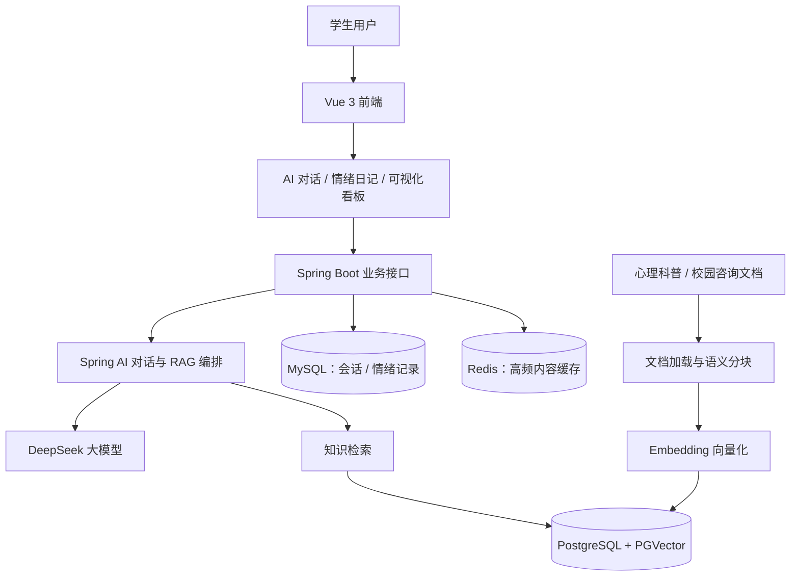
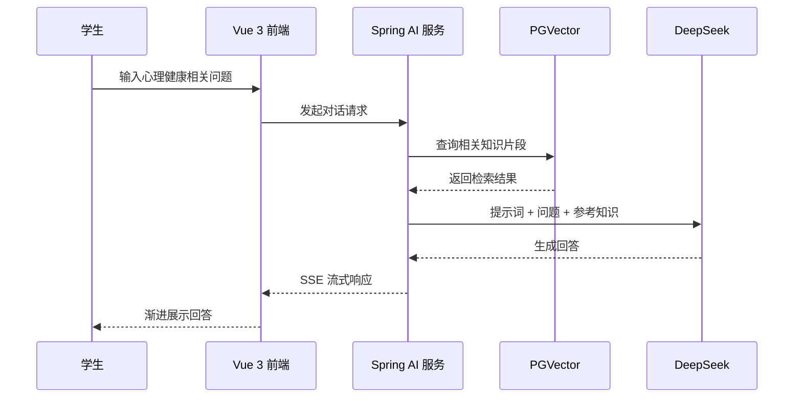

<div align="center">

# 🌿 心晴校园 · Campus Mind

### 基于 Spring AI + RAG 的校园心理健康智能助手

**让心理知识更易获取，让每一次倾诉都有回应。**

[](https://www.java.com/)
[](https://spring.io/projects/spring-boot)
[](https://spring.io/projects/spring-ai)
[](https://www.deepseek.com/)
[](https://vuejs.org/)
[](https://github.com/pgvector/pgvector)

[项目简介](#-项目简介) · [核心功能](#-核心功能) · [技术架构](#-技术架构) · [快速开始](#-快速开始) · [技术亮点](#-技术亮点)

</div>

---

## 📖 项目简介

**心晴校园（Campus Mind）** 是一个面向高校学生的心理健康 AI 应用项目，针对校园心理咨询资源有限、心理知识获取分散，以及部分学生不愿主动寻求帮助等问题，探索以 **检索增强生成（RAG）+ 大模型对话** 提供低门槛、可持续的心理健康信息支持。

项目采用 **Spring Boot + Spring AI** 构建后端服务，集成 **DeepSeek 大模型** 实现面向校园情境的多轮交流；使用 **Embedding 模型 + PGVector** 建设心理学科普与校园咨询指南知识库，以检索结果辅助回答生成；通过 **MySQL、Redis** 管理业务数据和高频内容，并使用 **Vue 3 + ECharts** 展示情绪记录与趋势。

> **项目定位**：心理健康科普、情绪记录和支持性对话工具，**不能替代专业心理咨询、医学诊断或紧急危机干预服务**。

## ✨ 核心功能

| 功能模块 | 功能说明 | 关键技术 |
| --- | --- | --- |
| 💬 AI 心理陪伴 | 面向校园学习、人际关系、情绪压力等场景开展支持性多轮对话，支持逐字流式响应 | Spring AI、DeepSeek、Prompt、SSE |
| 📚 心理知识问答 | 从心理科普文档、校园咨询指南等资料中召回相关内容，辅助生成更贴近知识库的回答 | RAG、Embedding、PGVector |
| 🧠 多轮会话管理 | 管理对话上下文及历史会话信息，提升连续交流体验 | 会话记忆、MySQL |
| 📝 情绪日记 | 记录情绪状态与个人感受，支持回顾历史情绪记录 | MySQL |
| 📊 情绪可视化 | 将情绪记录转化为可读的趋势和统计图表 | Vue 3、ECharts |
| ⚡ 高频内容缓存 | 对适合缓存的高频心理科普内容进行缓存，减少重复读取开销 | Redis |

> 功能依据项目设计与简历说明整理；具体页面、接口及实现状态请以仓库中的实际代码为准。

## 🏗 技术架构



### 技术栈

| 层次 | 主要技术 | 作用 |
| --- | --- | --- |
| 前端展示 | Vue 3、ECharts | 对话交互、情绪记录、数据可视化 |
| 后端服务 | Java、Spring Boot | 接口服务与业务逻辑 |
| AI 能力 | Spring AI、DeepSeek | 模型调用、提示词编排、多轮对话与流式输出 |
| 检索增强 | Document Loader、Text Splitter、Embedding、PGVector | 文档处理、向量化、相似度检索 |
| 数据存储 | MySQL | 会话信息和情绪记录等业务数据持久化 |
| 缓存 | Redis | 高频知识内容缓存 |
| 通信 | HTTP、SSE | 常规业务请求与 AI 回答流式推送 |

## 🔎 RAG 知识问答流程

项目将知识库构建与在线问答分为两个主要阶段。

**知识库构建（离线流程）**

1. **资料加载**：导入心理学科普材料、校园心理咨询指南等多源文档。
2. **文本预处理**：清洗、解析并按语义进行切分，调整分块大小与重叠度。
3. **向量化**：调用 Embedding 模型生成文本片段的向量表示。
4. **索引存储**：将文本片段及相应向量保存至 PGVector，以供后续检索。

**检索增强问答（在线流程）**

1. 接收学生问题及适当的会话上下文。
2. 将问题转换为查询向量，执行向量相似度检索。
3. 将召回的相关知识片段与提示词模板组合，构造模型输入。
4. 调用 DeepSeek 生成回答，并通过 SSE 流式返回前端。
5. 根据业务需要保存会话记录，供用户回顾或后续对话使用。



## 💡 技术亮点

### 01｜基于 Spring AI 的领域知识库构建

通过文档加载与语义分块将非结构化心理科普材料转为可检索的知识单元，并围绕**分块粒度、重叠比例与上下文完整性**优化切片效果，为后续向量召回提供数据基础。

### 02｜PGVector 语义检索增强

使用 Embedding 模型生成向量，基于 **PostgreSQL + PGVector** 实现相似度召回。将外部知识片段注入模型上下文，降低完全依赖模型参数记忆回答所带来的知识偏差风险。**RAG 可以辅助降低幻觉，但不能保证回答完全正确。**

### 03｜校园情境 Prompt 与多轮对话

利用 Spring AI 集成 DeepSeek，为学业压力、情绪困扰、人际关系等常见校园场景组织提示词；结合多轮会话上下文与 **SSE 流式输出**，改善交流的连贯性和响应体验。

### 04｜业务数据与可视化闭环

以 **MySQL** 管理会话及情绪记录，以 **Redis** 支持高频内容缓存；前端使用 **Vue 3 + ECharts** 将日记记录转化为情绪趋势信息，连接“**AI 对话—情绪记录—知识科普**”的主要使用场景。

## 🚀 快速开始

> **说明**：以下为通用的本地部署流程。仓库的实际目录名、Java/Node.js 版本、配置键、数据库初始化脚本和运行命令需以源代码中的 `pom.xml`、`package.json`、`application.yml` 等文件为准。

### 1. 获取代码

```bash
git clone https://github.com/xiaocongfree2003/campus-mind-rag-assistant.git
cd campus-mind-rag-assistant
```

### 2. 准备依赖环境

- 安装与项目一致的 **JDK** 及 **Maven**（若使用 Maven Wrapper，也可以使用项目自带的 `mvnw`）。
- 安装与前端项目兼容的 **Node.js / npm**。
- 准备 **MySQL**、支持 `pgvector` 扩展的 **PostgreSQL**，以及 **Redis**。
- 准备可用的 **DeepSeek API 凭据**与项目所使用的 **Embedding 模型服务**。

如果使用独立 PostgreSQL 实例，请在相应数据库中按权限启用扩展：

```sql
CREATE EXTENSION IF NOT EXISTS vector;
```

### 3. 配置服务

在后端实际使用的配置文件或环境变量中，按代码要求填写：

- 大模型接口地址、模型名称和访问密钥；
- Embedding 模型配置；
- PostgreSQL / PGVector 连接参数；
- MySQL 数据源连接参数；
- Redis 连接参数；
- 其他必要的服务端口、跨域或会话配置。

**不要将 API Key、数据库密码、真实用户心理记录提交到公开仓库。** 推荐使用本地环境变量或不纳入版本控制的私有配置文件，并提供不含密钥的示例配置。

### 4. 启动项目

**后端（在包含 `pom.xml` 的目录下）**：

```bash
mvn spring-boot:run
```

如果项目附带 Maven Wrapper，则可优先使用 `./mvnw spring-boot:run`（Windows PowerShell 可使用 `./mvnw.cmd spring-boot:run`）。

**前端（在包含 `package.json` 的目录下）**：

```bash
npm install
npm run dev
```

前端命令仅适用于 `package.json` 中定义了 `dev` 脚本的项目。服务启动后，使用终端实际显示的本地访问地址打开网页。

## 🖼 页面展示

建议在 `docs/screenshots/` 中补充真实运行截图，并在此处展示：**AI 对话页、情绪日记页、情绪趋势看板、知识问答效果**。

目前不放置未经确认的演示图片，以免出现失效链接或与实际功能不符的界面。

## 🛡 使用边界与隐私提示

心理健康场景需要特别关注回答的可靠性和用户数据的敏感性：

- **非医疗用途**：本项目提供科普与支持性互动，不提供疾病诊断、治疗处方或对心理状态的医学判定。
- **紧急情况**：当用户存在立即伤害自己或他人的风险时，应优先联系当地紧急救助服务、校园值班人员或专业心理危机干预机构，而不是依赖 AI 对话。
- **数据最小化**：开发和展示时使用脱敏或模拟数据，不公开学生身份、会话原文和个人情绪记录。
- **回答可靠性**：模型输出可能存在遗漏或错误，重要心理健康信息应结合权威资料与专业人员意见核实。

> 上述内容是项目的**使用边界与安全建议**，并不代表代码已实现完整的隐私合规、危机识别或安全审查机制。

## 🧭 后续完善方向

- [ ] 补充项目真实运行截图和功能演示视频。
- [ ] 补充与实际代码一致的一键启动脚本、数据库初始化说明和示例配置。
- [ ] 建立 RAG 检索与生成效果的离线评测集，记录可复现的检索和回答质量指标。
- [ ] 进一步完善敏感话题识别、转介提示、权限控制与隐私保护机制。
- [ ] 根据实际开发情况补充自动化测试与部署流程。

## 🔗 项目地址

**GitHub**：https://github.com/xiaocongfree2003/campus-mind-rag-assistant

如果这个项目对你有帮助，欢迎通过 [Issues](https://github.com/xiaocongfree2003/campus-mind-rag-assistant/issues) 提出反馈。

---

<div align="center">

**Campus Mind · 心晴校园**  
*以工程技术探索更易获得的校园心理健康支持。*

</div>
